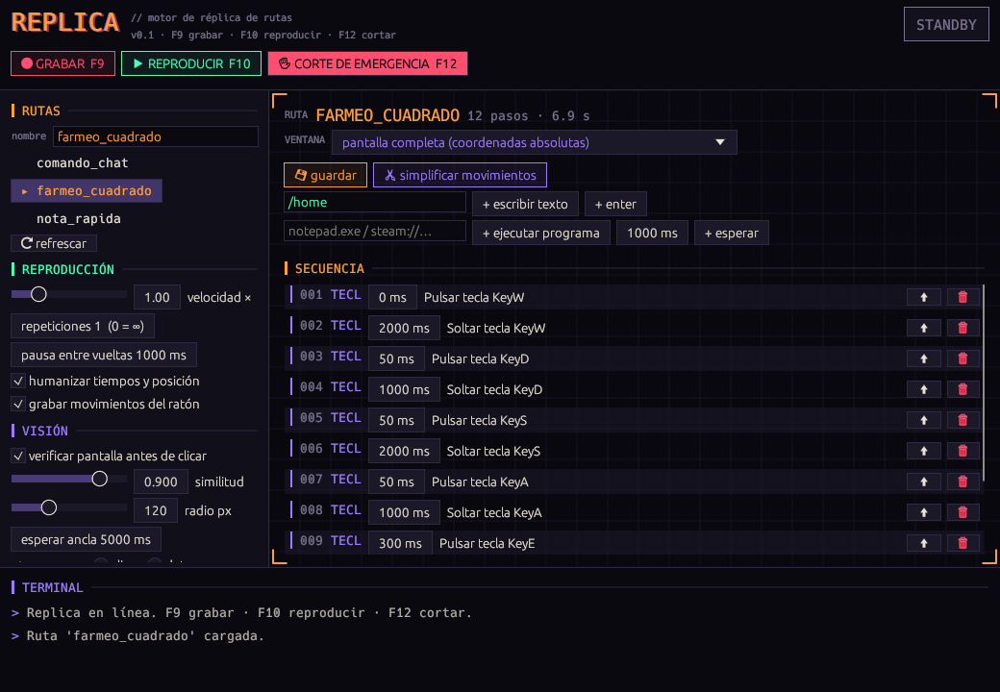

# Replica

**Graba lo que haces con el ratón y el teclado, mira tu pantalla y lo repite por ti.**

Replica es un grabador/reproductor de macros escrito en Rust. Pulsas `F9`, haces la tarea una vez
(una ruta de farmeo, un trabajo repetitivo, una secuencia de comandos…), vuelves a pulsar `F9`
y a partir de ahí `F10` la repite las veces que quieras. A diferencia de un macro clásico, Replica
**mira la pantalla** antes de cada clic y **se adapta** si la ventana se ha movido, ha cambiado de
tamaño o el juego todavía está cargando.



## Características

- **Grabación de todo**: teclas, clics, rueda y movimientos del ratón, con sus tiempos reales.
- **Visión de pantalla**: en cada clic guarda un recorte de la pantalla (ancla visual). Al reproducir,
  lo busca antes de clicar: si se movió, clica donde está ahora; si aún no aparece, espera.
- **Independiente de la resolución**: recuerda la ventana sobre la que grabaste y, al reproducir,
  adapta todas las coordenadas a su posición y tamaño actuales.
- **Repeticiones** (o bucle infinito), velocidad de ×0.25 a ×4 y pausa entre vueltas.
- **Humanización**: pequeñas variaciones aleatorias de tiempo (±15 %) y posición (±2 px).
- **Editor de pasos**: cambia retardos, borra, reordena y añade pasos a mano:
  escribir texto, pulsar Enter, ejecutar programas y esperas.
- **Atajos globales** que funcionan con el juego en primer plano, y **corte de emergencia** que
  suelta todas las teclas y botones pulsados.
- **Rutas en JSON** legibles y editables a mano.

## Instalación

Necesitas [Rust](https://rustup.rs) (1.85 o superior).

```bash
git clone https://github.com/AngelazoGit/Replica.git
cd Replica
cargo run --release
```

### Requisitos por sistema

| Sistema | Qué hace falta |
|---|---|
| **Windows** | Nada más. |
| **macOS** | Dar a la terminal (o a la app) permisos de *Accesibilidad* y *Grabación de pantalla* en Ajustes del sistema → Privacidad y seguridad. |
| **Linux** | Sesión **X11** (en Wayland no se puede leer la entrada global) y estas librerías: |

```bash
sudo apt install libx11-dev libxtst-dev libxi-dev libdbus-1-dev libxkbcommon-x11-0 libpipewire-0.3-dev clang
```

## Uso rápido

1. Abre Replica y escribe un **nombre** para la ruta (panel *RUTAS*).
2. Ve al juego o programa y pulsa **`F9`**: el indicador pasa a `● REC`.
3. Haz la tarea una vez con normalidad.
4. Pulsa **`F9`** otra vez: la ruta se guarda en `routes/<nombre>/`.
5. Ajusta las repeticiones y pulsa **`F10`** para que Replica la repita.
6. **`F12`** lo para todo en cualquier momento.

| Atajo | Acción |
|---|---|
| `F9` | Empezar / terminar la grabación |
| `F10` | Reproducir / parar la ruta cargada |
| `F12` | Corte de emergencia |

> Consejo: usa los atajos en lugar de los botones de la app para no grabar el paso de ir a Replica a pulsar.
> Si grabas con un nombre que ya existe, Replica crea `nombre_2`, `nombre_3`… y nunca sobrescribe.

## Ejemplos

En [`examples/routes`](examples/routes) hay tres rutas listas para probar. Cópialas a la carpeta
`routes/` (junto al ejecutable, o en la raíz del proyecto si usas `cargo run`):

```bash
cp -r examples/routes routes
```

En Windows (PowerShell):

```powershell
Copy-Item -Recurse examples\routes routes
```

Pulsa **⟳ refrescar** en Replica y aparecerán en la lista.

| Ruta | Qué hace | Para probarla |
|---|---|---|
| [`nota_rapida`](examples/routes/nota_rapida/route.json) | Abre el Bloc de notas y escribe un mensaje. | Pulsa `F10` en Windows. En Linux/macOS cambia `notepad.exe` por `gedit` u `open -a TextEdit` en el editor. |
| [`comando_chat`](examples/routes/comando_chat/route.json) | Abre el chat con `T`, escribe `/home` y pulsa Enter. Útil en juegos tipo sandbox. | Pon el juego en primer plano y pulsa `F10`. |
| [`farmeo_cuadrado`](examples/routes/farmeo_cuadrado/route.json) | Camina en cuadrado con `W` `D` `S` `A`, interactúa con `E` y salta. | Pon repeticiones a `0` (infinito), entra al juego y pulsa `F10`. |

Las rutas de ejemplo no usan clics, así que funcionan con cualquier resolución.
Graba las tuyas propias para que incluyan anclas visuales y ventana objetivo.

## Cómo funciona

### Anclas visuales

En cada clic Replica guarda un recorte de 48×48 px de la pantalla alrededor del cursor
(`anchor_XXXX.png`). Ese recorte sale de una captura continua hecha **justo antes del clic**,
para no guardar la pantalla ya cambiada por el juego (un menú que se abre al pulsar, por ejemplo).

Al reproducir, antes de cada clic busca ese recorte en un radio alrededor del punto esperado:

- **Lo encuentra en otro sitio** → clica donde está ahora.
- **No aparece todavía** (pantalla de carga, lag) → espera hasta el tiempo límite y, según el
  ajuste, clica igualmente o detiene la ruta.

Pasa el ratón por encima de un paso `CLIC` en el editor para ver el recorte que buscará.

### Ventana objetivo y resolución

La ventana que hay bajo el primer clic queda guardada como **ventana objetivo** (aplicación,
título, posición y tamaño). Al reproducir, en cada vuelta Replica vuelve a buscarla y traslada
todas las coordenadas a su posición y tamaño actuales: puedes grabar en una ventana de 1280×720
y reproducir en otra de 1920×1080, o con la ventana en otro sitio.

Los recortes también se reescalan. Como los juegos escalan su interfaz con la ventana y las apps
de escritorio no, Replica prueba el recorte escalado y el original y se queda con el mejor.

Si la detección automática no acierta, elige la ventana correcta en el selector **VENTANA**,
o *pantalla completa* para usar coordenadas absolutas.

### Tiempos

La reproducción sigue un reloj absoluto: el tiempo que tarda en simular cada evento no se acumula,
así que una ruta de 10 minutos dura 10 minutos. Tras una espera larga (un ancla que tarda en
aparecer), los pasos siguientes no se disparan de golpe.

## Ajustes

| Ajuste | Qué hace |
|---|---|
| **velocidad ×** | Multiplica la velocidad de reproducción. |
| **repeticiones** | Número de vueltas; `0` = infinito. |
| **pausa entre vueltas** | Espera entre una vuelta y la siguiente. |
| **humanizar** | Variación aleatoria de tiempos y posición de los clics. |
| **grabar movimientos del ratón** | Si se desactiva, solo se graban los clics (rutas más ligeras). |
| **verificar pantalla antes de clicar** | Activa la búsqueda de anclas visuales. |
| **similitud** | Lo parecido que debe ser el recorte (0,90 = 90 %). Bájalo si hay efectos o animaciones. |
| **radio px** | Cuánto puede haberse desplazado el elemento respecto a donde estaba. |
| **esperar ancla** | Tiempo máximo esperando a que aparezca el recorte. |
| **si no aparece** | `clicar` en la posición grabada o `detener` la ruta. |

## Formato de las rutas

Cada ruta es una carpeta en `routes/` con un `route.json` y las anclas en PNG:

```json
{
  "name": "comando_chat",
  "target": null,
  "steps": [
    { "delay_ms": 0,   "action": { "KeyDown": { "key": "KeyT" } } },
    { "delay_ms": 60,  "action": { "KeyUp":   { "key": "KeyT" } } },
    { "delay_ms": 400, "action": { "TypeText": { "text": "/home" } } }
  ]
}
```

`delay_ms` es el tiempo de espera desde el paso anterior. Acciones disponibles:

| Acción | Campos | Descripción |
|---|---|---|
| `MouseMove` | `x`, `y` | Mueve el ratón. |
| `ButtonDown` | `button`, `x`, `y`, `anchor` | Pulsa un botón (`Left`, `Right`, `Middle`) en un punto; `anchor` es el PNG a buscar o `null`. |
| `ButtonUp` | `button` | Suelta el botón. |
| `Wheel` | `dx`, `dy` | Gira la rueda. |
| `KeyDown` / `KeyUp` | `key` | Pulsa o suelta una tecla (`KeyA`…`KeyZ`, `Num0`…`Num9`, `Space`, `Return`, `Escape`, `F1`…, `ShiftLeft`, `ControlLeft`, `Alt`…). |
| `TypeText` | `text` | Escribe un texto (`\n` = Enter). |
| `RunCommand` | `command` | Lanza un programa o comando del sistema. |
| `Wait` | `ms` | Espera. |

`target` (opcional) es la ventana objetivo: `{ "app", "title", "x", "y", "w", "h" }`.

## Estructura del proyecto

| Archivo | Contenido |
|---|---|
| [`src/main.rs`](src/main.rs) | Arranque de la app. |
| [`src/bot.rs`](src/bot.rs) | Escucha global, grabación, reproductor, atajos y humanización. |
| [`src/vision.rs`](src/vision.rs) | Capturas, búsqueda de recortes y detección de ventanas. |
| [`src/model.rs`](src/model.rs) | Rutas, pasos, acciones y ventana objetivo (JSON). |
| [`src/app.rs`](src/app.rs) | Interfaz gráfica (egui). |
| [`src/theme.rs`](src/theme.rs) | Estética: paleta «Sodio y Ultravioleta» y efectos HUD. |
| [`examples/drive.rs`](examples/drive.rs) | Simulador de entrada para pruebas de extremo a extremo. |
| [`examples/routes`](examples/routes) | Rutas de ejemplo. |

## Pruebas

```bash
cargo test
```

Para una prueba de extremo a extremo, abre Replica y en otra terminal ejecuta el simulador,
que pulsa `F9`, hace unas acciones, pulsa `F9` y luego `F10`:

```bash
cargo run --release --example drive -- record
```

```bash
cargo run --release --example drive -- play
```

## Limitaciones

- **Escribir texto** usa la distribución de teclado US: letras, números y espacios funcionan con
  cualquier teclado, pero algunos símbolos (`/`, `?`, `:`…) pueden salir distintos con otras
  distribuciones, y con Bloq Mayús activo se invierten las mayúsculas. En ese caso, graba las teclas.
- El reescalado es proporcional al tamaño de la ventana. Si cambias la relación de aspecto
  (16:9 → 4:3) y el juego añade bandas negras, los clics se desplazan; las anclas lo corrigen
  dentro del radio de búsqueda.
- En Linux la ventana objetivo se elige como la más pequeña que contiene el clic (X11 no da el
  orden de las ventanas). Si no acierta, cámbiala en el selector.
- Mientras grabas se captura la zona del cursor 25 veces por segundo; en monitores 4K puede
  notarse en el uso de CPU.
- Algunos juegos con anti-cheat a nivel de kernel ignoran o detectan la entrada simulada.

## Uso responsable

**Muchos juegos online prohíben los bots y macros en sus términos de servicio y pueden suspender
tu cuenta.** Usa Replica en juegos para un jugador, en servidores donde esté permitido o para
automatizar tus propias tareas. Tú eres responsable de cómo lo uses.

## Licencia

[MIT](LICENSE)
