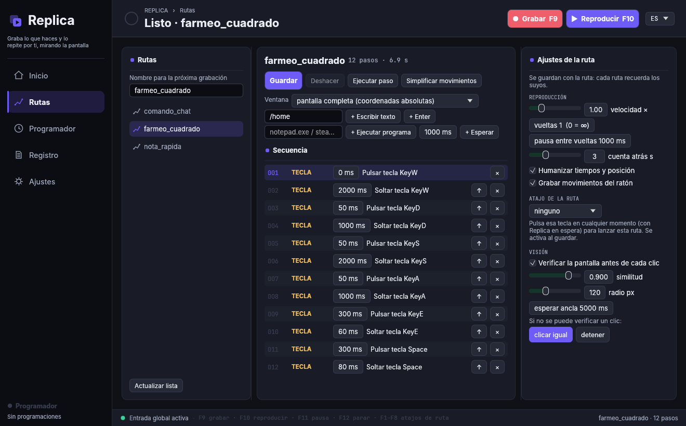

# Replica

**Graba lo que haces con el ratón y el teclado, mira tu pantalla y lo repite por ti.**

Replica es un grabador/reproductor de macros escrito en Rust. Pulsas `F9`, haces la tarea una vez
(una ruta de farmeo, un trabajo repetitivo, una secuencia de comandos…), vuelves a pulsar `F9`
y a partir de ahí `F10` la repite las veces que quieras. A diferencia de un macro clásico, Replica
**mira la pantalla** antes de cada clic y **se adapta** si la ventana se ha movido, ha cambiado de
tamaño o el juego todavía está cargando.



## Características

- **Grabación de todo**: teclas, clics, rueda y movimientos del ratón, con sus tiempos reales.
- **Visión de pantalla**: en cada clic guarda un recorte de la pantalla (ancla visual). Al reproducir,
  lo busca antes de clicar: si se movió, clica donde está ahora; si aún no aparece, espera.
- **Independiente de la resolución**: recuerda la ventana sobre la que grabaste y, al reproducir,
  adapta todas las coordenadas a su posición y tamaño actuales.
- **Repeticiones** (o bucle infinito), velocidad de ×0.25 a ×4 y pausa entre vueltas.
- **Humanización**: pequeñas variaciones aleatorias de tiempo (±15 %) y posición (±2 px).
- **Editor de pasos**: cambia retardos, borra, reordena y añade pasos a mano:
  escribir texto, pulsar Enter, ejecutar programas y esperas.
- **Recetas rápidas sin grabar nada**: autoclicker, anti-AFK y repetir tecla, con un botón en Inicio.
- **Grabar sin pensar**: nombre automático con fecha y hora, Replica se minimiza mientras grabas,
  quita los movimientos sobrantes del final y, si quieres, recorta las esperas largas.
- **Aviso al terminar o fallar**: sonido (Windows), parpadeo en la barra de tareas y aviso en la app.
- **Reintentar en vez de parar**: si un paso falla, la vuelta empieza otra vez (hasta N veces).
- **Repetir hasta que…**: las vueltas siguen hasta que una imagen aparezca o desaparezca
  (por ejemplo, «inventario lleno»).
- **Encadenar rutas**: un paso que ejecuta otra ruta («ir → farmear → volver → vender»).
- **Control de reproducción**: pausa y sigue con `F11` (suelta las teclas mantenidas y las vuelve a
  pulsar al seguir), ejecuta un solo paso para depurar, cuenta atrás antes de empezar y barra de
  progreso de la vuelta.
- **Ajustes por ruta**: cada ruta guarda su velocidad, vueltas, cuenta atrás, política visual y atajo.
  Deshacer (`Ctrl+Z`), guardar (`Ctrl+S`) y aviso de cambios sin guardar.
- **Programador**: lanza una ruta cada día a una hora o cada X minutos.
- **Atajos por ruta**: asigna `F1`–`F8` a una ruta y lánzala al momento, con el juego en primer plano.
- **Texto Unicode**: escribe ñ, tildes y cualquier símbolo sin depender de la distribución del teclado.
- **Bandeja del sistema** (Windows): al cerrar la ventana sigue funcionando con atajos y programador.
- **10 idiomas**: español, English, 中文, Français, Português, Русский, Deutsch, 日本語, 한국어 e Italiano.
- **Máscaras visuales**: la interfaz de [CAPAS](https://github.com/AngelazoGit/capas) con sus cinco
  paletas (Serio, Limpio, Sereno, Neutro y Mando) y «Sodio», la estética original de Replica.
- **Atajos globales** que funcionan con el juego en primer plano, y **corte de emergencia** que
  suelta todas las teclas y botones pulsados.
- **Rutas en JSON** legibles y editables a mano.

## Descarga (Windows, portable)

1. Descarga `Replica-vX.Y.Z-windows-x64-portable.zip` (la versión más reciente) desde
   [Releases](https://github.com/AngelazoGit/Replica/releases/latest).
2. Descomprímelo donde quieras (escritorio, USB, otra unidad…) y abre `Replica\Replica.exe`.

No necesita instalación ni dependencias: solo Windows 10 u 11 de 64 bits. Es **portable**: las rutas
se guardan en la carpeta `routes\` junto al `.exe`, así que para llevártelo a otro PC basta con
copiar la carpeta entera. El zip ya trae las rutas de ejemplo.

> Windows SmartScreen puede avisar porque el `.exe` no está firmado: pulsa *Más información →
> Ejecutar de todas formas*. Si el juego se ejecuta como administrador, abre Replica también como
> administrador; si no, Windows bloquea los clics simulados.

## Compilar desde el código

Necesitas [Rust](https://rustup.rs) (1.85 o superior).

```bash
git clone https://github.com/AngelazoGit/Replica.git
cd Replica
cargo run --release
```

Las rutas se guardan en `routes/` junto al ejecutable; con `cargo run --release` es
`target/release/routes/`.

### Requisitos por sistema

| Sistema | Qué hace falta |
|---|---|
| **Windows** | Nada más. |
| **macOS** | Dar a la terminal (o a la app) permisos de *Accesibilidad* y *Grabación de pantalla* en Ajustes del sistema → Privacidad y seguridad. |
| **Linux** | Sesión **X11** (en Wayland no se puede leer la entrada global) y estas librerías: |

```bash
sudo apt install libx11-dev libxtst-dev libxi-dev libdbus-1-dev libxkbcommon-x11-0 libpipewire-0.3-dev clang
```

## Uso rápido

1. Abre Replica, ve a **Rutas** y escribe un **nombre** para la próxima grabación.
2. Ve al juego o programa y pulsa **`F9`**: la insignia de la cabecera se pone roja.
3. Haz la tarea una vez con normalidad.
4. Pulsa **`F9`** otra vez: la ruta se guarda en `routes/<nombre>/`.
5. Ajusta las vueltas en *Ajustes de la ruta* y pulsa **`F10`** para que Replica la repita
   (tras la cuenta atrás, para que te dé tiempo a volver al juego).
6. **`F11`** la pausa y **`F12`** lo para todo en cualquier momento.

| Atajo | Acción |
|---|---|
| `F9` | Empezar / terminar la grabación |
| `F10` | Reproducir / parar la ruta cargada |
| `F11` | Pausa / seguir (suelta las teclas mantenidas mientras está en pausa) |
| `F12` | Corte de emergencia: para la ruta y suelta teclas y botones |
| `F1`–`F8` | Lanza la ruta que tenga asignado ese atajo |
| `Ctrl+Z` / `Ctrl+S` | Deshacer / guardar en el editor |

Cerrar Replica mientras reproduce también para la ruta y suelta lo que estuviera pulsado.
`F12` no cierra los programas que la ruta ya haya abierto con *ejecutar programa*.

> Consejo: usa los atajos en lugar de los botones de la app para no grabar el paso de ir a Replica a pulsar.
> Si grabas con un nombre que ya existe, Replica crea `nombre_2`, `nombre_3`… y nunca sobrescribe.

## Ejemplos

En [`examples/routes`](examples/routes) hay tres rutas listas para probar. El zip portable ya
las incluye. Si compilas desde el código, cópialas a la carpeta `routes/` junto al ejecutable:

```bash
cp -r examples/routes target/release/routes
```

En Windows (PowerShell):

```powershell
Copy-Item -Recurse examples\routes target\release\routes
```

Pulsa **Actualizar lista** en Replica y aparecerán.

| Ruta | Qué hace | Para probarla |
|---|---|---|
| [`nota_rapida`](examples/routes/nota_rapida/route.json) | Abre el Bloc de notas y escribe un mensaje. | Pulsa **permitir** (ejecuta un programa) y luego `F10` en Windows. En Linux/macOS cambia `notepad.exe` por `gedit` u `open -a TextEdit` en el editor. |
| [`comando_chat`](examples/routes/comando_chat/route.json) | Abre el chat con `T`, escribe `/home` y pulsa Enter. Útil en juegos tipo sandbox. | Pon el juego en primer plano y pulsa `F10`. |
| [`farmeo_cuadrado`](examples/routes/farmeo_cuadrado/route.json) | Camina en cuadrado con `W` `D` `S` `A`, interactúa con `E` y salta. | Pon repeticiones a `0` (infinito), entra al juego y pulsa `F10`. |

Las rutas de ejemplo no usan clics, así que funcionan con cualquier resolución.
Graba las tuyas propias para que incluyan anclas visuales y ventana objetivo.

## Cómo funciona

### Anclas visuales

En cada clic Replica guarda un recorte de 48×48 px de la pantalla alrededor del cursor
(`anchor_XXXX.png`). Ese recorte sale de una captura continua hecha **justo antes del clic**,
para no guardar la pantalla ya cambiada por el juego (un menú que se abre al pulsar, por ejemplo).

Al reproducir, antes de cada clic busca ese recorte en un radio alrededor del punto esperado:

- **Lo encuentra en otro sitio** → clica donde está ahora.
- **No aparece todavía** (pantalla de carga, lag) → espera hasta el tiempo límite y, según el
  ajuste, clica igualmente o detiene la ruta.

Pasa el ratón por encima de un paso `CLIC` en el editor para ver el recorte que buscará.

### Ventana objetivo y resolución

La ventana que hay bajo el primer clic queda guardada como **ventana objetivo** (aplicación,
título, posición y tamaño). Al reproducir, en cada vuelta Replica vuelve a buscarla y traslada
todas las coordenadas a su posición y tamaño actuales: puedes grabar en una ventana de 1280×720
y reproducir en otra de 1920×1080, o con la ventana en otro sitio.

Los recortes también se reescalan. Como los juegos escalan su interfaz con la ventana y las apps
de escritorio no, Replica prueba el recorte escalado y el original y se queda con el mejor.

Si la detección automática no acierta, elige la ventana correcta en el selector **VENTANA**,
o *pantalla completa* para usar coordenadas absolutas.

### Rutas que ejecutan programas

Una ruta puede lanzar programas o comandos del sistema (*ejecutar programa*). Al cargar una ruta
que lo hace, Replica muestra la lista de comandos y no la reproduce hasta que pulsas **permitir**.
Hazlo solo con rutas de alguien de confianza: esos comandos se ejecutan con tus permisos.
Las rutas que grabas o editas tú no lo piden.

### Recetas rápidas

En **Inicio** hay tres recetas que no hace falta grabar. Se repiten hasta que pulsas `F12` y
empiezan tras una cuenta atrás de 3 s:

| Receta | Qué hace |
|---|---|
| **Autoclicker** | Clic izquierdo o derecho donde esté el ratón, cada X ms. |
| **Anti-AFK** | Pulsa una tecla cada N minutos (con tiempos variados) para no quedar inactivo. |
| **Repetir tecla** | Pulsa una tecla cada X ms. |

### Repetir hasta que…, reintentos y rutas encadenadas

- **Parar cuando**: en *Ajustes de la ruta*, elige «aparezca» o «desaparezca», pon el ratón sobre
  lo que hay que vigilar y en 3 s se captura (`until.png`). Al final de cada vuelta Replica mira si
  esa imagen está y para cuando se cumple la condición. Con vueltas en `0` repite hasta entonces.
- **Reintentos**: si un paso falla (un recorte que no aparece, la ventana que no está…), la vuelta
  empieza de nuevo desde el principio hasta N veces antes de rendirse.
- **Ejecutar ruta**: en el editor, elige otra ruta y pulsa *+ Ejecutar ruta*. Se ejecuta una vuelta
  suya con sus propios ajustes y luego sigue la actual (hasta 4 niveles de encadenado).

### Programador y atajos de ruta

En **Programador** eliges una ruta y cuándo lanzarla: cada día a una hora o cada X minutos.
En *Ajustes de la ruta* puedes asignarle un atajo de `F1` a `F8`. Si en ese momento Replica está
ocupada o la ruta abierta tiene cambios sin guardar, esa ejecución se salta (queda en el registro).
Las rutas con programas solo se lanzan así si ya los permitiste. En Windows, cerrar la ventana deja
Replica en la bandeja del sistema para que todo siga funcionando (se puede desactivar en Ajustes).

### Idiomas

Replica detecta el idioma del sistema y se puede cambiar en la cabecera o en **Ajustes**. Chino,
japonés y coreano usan la fuente CJK que ya trae el sistema (Microsoft YaHei, Yu Gothic, Malgun
Gothic, Noto CJK…), así el ejecutable no pesa decenas de MB más. Árabe e hindi no están: la librería
de interfaz no da forma a esos alfabetos y se verían con las letras sueltas.

Las traducciones están en [`src/i18n.txt`](src/i18n.txt); el texto en español del código es la
clave. Un test comprueba que cada texto tiene sus 9 traducciones.

### Tiempos

La reproducción sigue un reloj absoluto: el tiempo que tarda en simular cada evento no se acumula,
así que una ruta de 10 minutos dura 10 minutos. Tras una espera larga (un ancla que tarda en
aparecer), los pasos siguientes no se disparan de golpe.

## Ajustes

Se guardan con cada ruta (*Rutas → Ajustes de la ruta*).

| Ajuste | Qué hace |
|---|---|
| **velocidad ×** | Multiplica la velocidad de reproducción. |
| **vueltas** | Número de vueltas; `0` = infinito. |
| **pausa entre vueltas** | Espera entre una vuelta y la siguiente. |
| **cuenta atrás** | Segundos antes de empezar, para volver a la ventana del juego. |
| **atajo de la ruta** | `F1`–`F8` para lanzarla en cualquier momento. |
| **reintentos** | Veces que se repite una vuelta que falla antes de parar. |
| **parar cuando** | Nunca, o cuando la imagen de parada aparezca o desaparezca. |
| **recortar esperas** | Al grabar, las esperas de más de N s se acortan a N s (`0` = no). |
| **humanizar** | Variación aleatoria de tiempos y posición de los clics. |
| **grabar movimientos del ratón** | Si se desactiva, solo se graban los clics (rutas más ligeras). |
| **verificar pantalla antes de clicar** | Activa la búsqueda de anclas visuales. |
| **similitud** | Lo parecido que debe ser el recorte (0,90 = 90 %). Bájalo si hay efectos o animaciones. |
| **radio px** | Cuánto puede haberse desplazado el elemento respecto a donde estaba. |
| **esperar ancla** | Tiempo máximo esperando a que aparezca el recorte. |
| **si no aparece** | Qué hacer cuando no se puede verificar un clic: el recorte no aparece a tiempo, su PNG falta o está dañado, falla la captura o no se encuentra la ventana objetivo. `clicar` sigue con la posición grabada; `detener` para la ruta sin clicar. |

## Formato de las rutas

Cada ruta es una carpeta en `routes/` con un `route.json` y las anclas en PNG:

```json
{
  "name": "comando_chat",
  "target": null,
  "steps": [
    { "delay_ms": 0,   "action": { "KeyDown": { "key": "KeyT" } } },
    { "delay_ms": 60,  "action": { "KeyUp":   { "key": "KeyT" } } },
    { "delay_ms": 400, "action": { "TypeText": { "text": "/home" } } }
  ]
}
```

`delay_ms` es el tiempo de espera desde el paso anterior. Acciones disponibles:

| Acción | Campos | Descripción |
|---|---|---|
| `MouseMove` | `x`, `y` | Mueve el ratón. |
| `ButtonDown` | `button`, `x`, `y`, `anchor` | Pulsa un botón (`Left`, `Right`, `Middle`) en un punto; `anchor` es el PNG a buscar o `null`. |
| `ButtonUp` | `button` | Suelta el botón. |
| `Wheel` | `dx`, `dy` | Gira la rueda. |
| `KeyDown` / `KeyUp` | `key` | Pulsa o suelta una tecla (`KeyA`…`KeyZ`, `Num0`…`Num9`, `Space`, `Return`, `Escape`, `F1`…, `ShiftLeft`, `ControlLeft`, `Alt`…). |
| `TypeText` | `text` | Escribe un texto (`\n` = Enter). |
| `RunCommand` | `command` | Lanza un programa o comando del sistema. |
| `Wait` | `ms` | Espera. |

`target` (opcional) es la ventana objetivo: `{ "app", "title", "x", "y", "w", "h" }`.

## Estructura del proyecto

| Archivo | Contenido |
|---|---|
| [`src/main.rs`](src/main.rs) | Arranque de la app. |
| [`src/bot.rs`](src/bot.rs) | Escucha global, grabación, reproductor (pausa, paso a paso, cuenta atrás), atajos, programador y humanización. |
| [`src/config.rs`](src/config.rs) | `replica.json`: máscara, idioma, programaciones y rutas permitidas. |
| [`src/i18n.rs`](src/i18n.rs) · [`src/i18n.txt`](src/i18n.txt) | Idiomas y traducciones. |
| [`src/tray.rs`](src/tray.rs) | Icono de la bandeja del sistema (Windows). |
| [`src/vision.rs`](src/vision.rs) | Capturas, búsqueda de recortes y detección de ventanas. |
| [`src/model.rs`](src/model.rs) | Rutas, pasos, acciones y ventana objetivo (JSON). |
| [`src/app.rs`](src/app.rs) | Interfaz: barra lateral, cabecera y las vistas Inicio, Rutas, Programador, Registro y Ajustes. |
| [`src/theme.rs`](src/theme.rs) | Máscaras visuales, fuentes (Inter + JetBrains Mono) y componentes. |
| [`examples/drive.rs`](examples/drive.rs) | Simulador de entrada para pruebas de extremo a extremo. |
| [`examples/routes`](examples/routes) | Rutas de ejemplo. |

### Generar el `.exe` de Windows desde Linux

```bash
rustup target add x86_64-pc-windows-gnu
```

```bash
sudo apt install gcc-mingw-w64-x86-64
```

```bash
cargo build --release --target x86_64-pc-windows-gnu
```

El resultado, `target/x86_64-pc-windows-gnu/release/replica.exe`, solo depende de DLL del sistema.
En Windows basta con `cargo build --release`.

### Publicar una versión

Las Releases se generan solas con GitHub Actions ([`release.yml`](.github/workflows/release.yml)):
compila en Windows, pasa los tests y publica el zip portable. Se lanza desde la web
(**Actions → Release → Run workflow**, indicando la versión) o subiendo una etiqueta:

```bash
git tag v0.1.1
```

```bash
git push origin v0.1.1
```

## Pruebas

```bash
cargo test
```

Los tests también se ejecutan en Windows con cada cambio ([`ci.yml`](.github/workflows/ci.yml)).

Para una prueba de extremo a extremo, abre Replica y en otra terminal ejecuta el simulador,
que pulsa `F9`, hace unas acciones, pulsa `F9` y luego `F10`:

```bash
cargo run --release --example drive -- record
```

```bash
cargo run --release --example drive -- play
```

## Limitaciones

- **Escribir texto**: letras, números y espacios se escriben con teclas físicas (los juegos las leen);
  el resto (símbolos, tildes, ñ…) como Unicode. Algunos juegos ignoran la entrada Unicode: si un
  símbolo no aparece, graba esas teclas en vez de escribirlas. Con Bloq Mayús activo se invierten
  las mayúsculas.
- El reescalado es proporcional al tamaño de la ventana. Si cambias la relación de aspecto
  (16:9 → 4:3) y el juego añade bandas negras, los clics se desplazan; las anclas lo corrigen
  dentro del radio de búsqueda.
- En Linux la ventana objetivo se elige como la más pequeña que contiene el clic (X11 no da el
  orden de las ventanas). Si no acierta, cámbiala en el selector.
- Mientras grabas se captura la zona del cursor 25 veces por segundo; en monitores 4K puede
  notarse en el uso de CPU.
- Los clics a menos de 24 px del borde de un monitor se graban sin ancla visual: el recorte no
  cabría entero y el clic no quedaría en su centro.
- Replica no comprueba qué ventana tiene el foco. Si cambias de ventana durante la reproducción,
  las teclas van a la ventana activa; usa `F12` o la política `detener`.
- Algunos juegos con anti-cheat a nivel de kernel ignoran o detectan la entrada simulada.

- El menú de la bandeja del sistema queda en el idioma con el que se abrió Replica.

## Uso responsable

**Muchos juegos online prohíben los bots y macros en sus términos de servicio y pueden suspender
tu cuenta.** Usa Replica en juegos para un jugador, en servidores donde esté permitido o para
automatizar tus propias tareas. Tú eres responsable de cómo lo uses.

## Licencia

[MIT](LICENSE)
